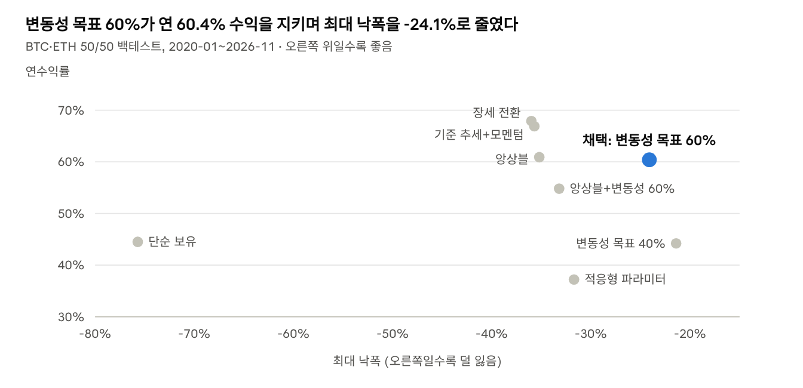
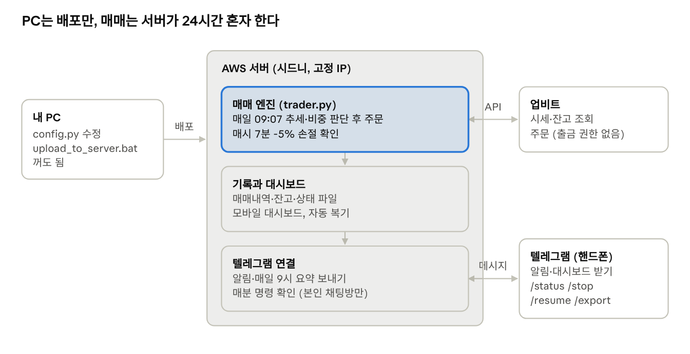

# 업비트 추세추종 자동매매 시스템

업비트에서 BTC·ETH를 규칙 기반으로 매매하는 자동매매 봇입니다. 6차례 백테스트로 전략을 검증했고, AWS 클라우드 서버에서 실제 자금으로 운영하고 있습니다 (2026-11~).

| 백테스트 (2020-01~2026-11, BTC·ETH 50/50) | 채택 전략 | 단순 보유 |
| --- | --- | --- |
| 연평균 수익률 | 60.4% | 44.5% |
| 최대 낙폭 (MDD) | -24.1% | -75.7% |
| 샤프 비율 | 1.66 | 0.91 |
| Calmar 비율 | 2.51 | 0.59 |

수수료 0.05%·슬리피지 0.05%를 반영했고, 신호는 종가로 만들고 체결은 다음 캔들 시가로 계산했습니다 (미래 정보 미사용). 과거 성과가 미래 수익을 보장하지는 않습니다.



## 전략

| 구성 요소 | 규칙 |
| --- | --- |
| 추세 필터 | 일봉 종가 > 200일 이동평균, 그리고 EMA12 > EMA26일 때만 보유 |
| 변동성 목표 비중 | 비중 = min(1, 60% ÷ 최근 20일 연환산 변동성) |
| 리밸런싱 밴드 | 목표와 10%p 이상 차이 날 때만 주문 |
| 손절 | 평균 매수가 대비 -5% (매시 확인), 신호가 다시 켜질 때까지 재진입 금지 |
| 종목 | BTC 50%, ETH 50% |

장세 전환, 적응형 파라미터, 앙상블, 공포·탐욕 지수도 같은 조건으로 검증했지만 채택하지 않았습니다. 수익률이 가장 높은 후보(장세 전환, 연 67.9%)는 낙폭이 -36%로 줄지 않았고, 위험 대비 성과(Calmar)는 변동성 목표 60%가 가장 높았습니다. 자세한 근거는 [시스템 기능 설명서](docs/SYSTEM_GUIDE.md)에 정리했습니다.

## 시스템 구성



- **매매 엔진** (`trader.py`): 업비트 REST API를 JWT로 직접 호출. 매일 09:07 판단, 매시 손절 감시, 체결 확인과 기록
- **안전장치**: 출금 권한 없는 API 키, 금액 한도, 하루 주문 횟수 제한, 이상 시 자동 정지, 중복 실행 잠금
- **모니터링**: 텔레그램 알림과 원격 명령(`/status` `/stop` `/resume` `/dashboard` `/export`), 모바일 대시보드
- **자동 복기** (`review.py`): 끝난 거래를 유형별로 분류하고, 패턴이 반복되면 수정안과 what-if 결과를 제시 (자동 적용은 하지 않음)
- **배포**: AWS Lightsail(Ubuntu) + cron, `install.sh`로 설치

## 파일

| 파일 | 역할 |
| --- | --- |
| `trader.py` | 매매 엔진 (업비트 연결, 주문, 기록, 안전장치) |
| `strategies.py`, `indicators.py` | 전략 규칙과 지표 계산 |
| `backtest.py`, `data.py` | 백테스트 엔진과 업비트 캔들 데이터 |
| `run.py`, `robustness.py`, `fng_test.py` | 전략 비교, 견고성 검사, 공포·탐욕 지수 검증 연구 스크립트 |
| `review.py`, `dashboard.py` | 매매 복기와 모바일 대시보드 |
| `notify.py`, `telegram_bot.py` | 텔레그램 알림과 명령 처리 |
| `config.py` | 설정값 (한도, 변동성 목표, 손절폭 등) |
| `install.sh`, `make_server_zip.py`, `upload_to_server.bat` | 서버 설치와 배포 |

## 실행

```bash
pip install -r requirements.txt
python run.py              # 백테스트와 전략 비교
python paper_trade.py      # 모의투자 1회 실행
```

실거래에는 `.env` 파일(업비트 API 키)이 필요합니다. `.env.example`을 참고하세요. 서버 운영 방법은 [docs/SERVER.md](docs/SERVER.md)에 있습니다.

## 문서

- [프로젝트 진행 기록](docs/PROJECT_LOG.md): 단계별 진행, 부딪힌 문제와 해결, 배운 점
- [시스템 기능 설명서](docs/SYSTEM_GUIDE.md): 전략을 이렇게 설정한 이유, 기능 상세

## 역할

전략 설계 방향, 검증 기준, 채택 결정, 실거래 운영과 리스크 관리는 직접 맡았고, 코드 구현은 AI(Claude)를 활용했습니다.

## 한계

여러 후보 중 고른 데 따른 선택 편향과, 현재 상장된 코인만 쓴 생존 편향이 있습니다. 일봉 기반이라 장중 급락 때의 실제 체결가는 백테스트보다 나쁠 수 있습니다. 이 저장소는 투자 권유가 아닙니다.
