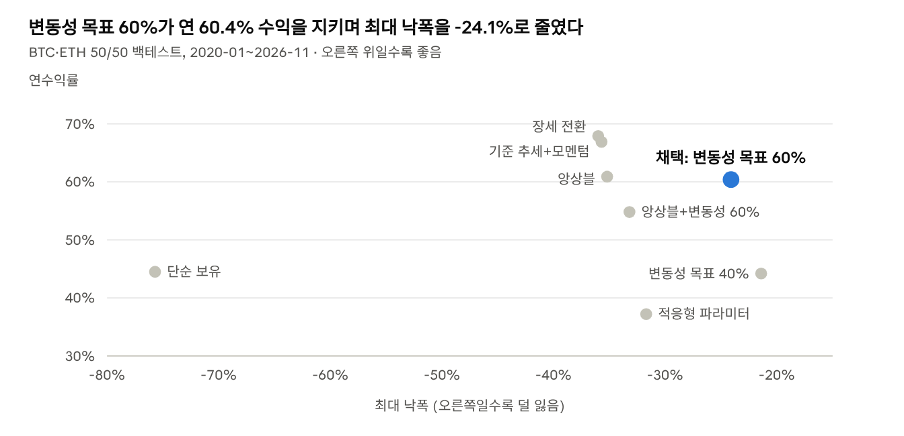
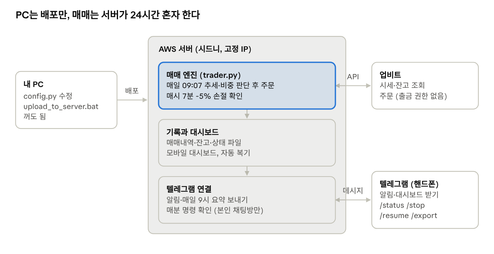

# 업비트 추세추종 자동매매 시스템

업비트에서 BTC·ETH를 규칙 기반으로 매매하는 자동매매 봇입니다. 6차례 백테스트로 전략을 검증했고, AWS 클라우드 서버에서 실제 자금으로 운영하고 있습니다 (2026-11~).

## 프로젝트 소개

퀀트 트레이딩 동아리 Forif에서 Freqtrade로 알고리즘 매매를 공부하면서 한 가지 의문이 생겼습니다. 백테스트에서 좋아 보이는 전략이 실제 시장에서도 그대로 작동할까? 이 질문에 직접 답해 보려고, 국내 거래소 업비트에서 실제 돈으로 돌아가는 시스템을 처음부터 끝까지 만들었습니다.

목표는 "가장 많이 버는 전략"이 아니라 "크게 잃지 않으면서 꾸준히 버는 전략"이었습니다. 암호화폐는 고점 대비 -70~-80%까지 빠지는 일이 반복되는 시장이라, 한 번의 큰 손실이 몇 년의 수익을 지울 수 있기 때문입니다. 그래서 전략을 고를 때 수익률보다 최대 낙폭과 위험 대비 성과(샤프, Calmar)를 우선했습니다.

시중에 많이 알려진 "AI에게 매번 매수·매도를 묻는" 방식은 택하지 않았습니다. 언어 모델은 과거 가격을 이미 학습했기 때문에 과거 데이터로 공정하게 검증할 수 없고, 같은 상황에서도 답이 달라질 수 있습니다. 대신 8년치 데이터로 검증할 수 있고, 매매마다 이유를 설명할 수 있는 규칙 기반 전략을 택했습니다.

| 백테스트 (2020-01~2026-11, BTC·ETH 50/50) | 채택 전략 | 단순 보유 |
| --- | --- | --- |
| 연평균 수익률 | 60.4% | 44.5% |
| 최대 낙폭 (MDD) | -24.1% | -75.7% |
| 샤프 비율 | 1.66 | 0.91 |
| Calmar 비율 | 2.51 | 0.59 |

수수료 0.05%·슬리피지 0.05%를 반영했고, 신호는 종가로 만들고 체결은 다음 캔들 시가로 계산했습니다 (미래 정보 미사용). 과거 성과가 미래 수익을 보장하지는 않습니다.



## 전략

### 쉽게 말하면

이 전략은 날씨를 보고 우산을 챙기는 것과 비슷합니다.

- **비가 그칠 때까지는 밖에 나가지 않는다 (추세 필터):** 가격이 200일 평균보다 위에 있고 최근 상승 힘도 살아 있을 때만 코인을 들고 있습니다. 둘 중 하나라도 꺾이면 전부 팔고 현금으로 기다립니다. 2018년, 2022년 같은 큰 하락장을 대부분 피할 수 있었던 이유입니다.
- **바람이 셀수록 조심해서 걷는다 (변동성 비중):** 시장이 평소보다 크게 출렁이면 들고 있는 비중을 자동으로 줄입니다. 출렁임이 두 배가 되면 비중은 절반이 됩니다. 이 장치 하나로 최대 낙폭이 -36%에서 -24%로 줄었습니다.
- **넘어지면 바로 일어나 쉬었다 간다 (손절):** 산 가격보다 5% 떨어지면 팔고, 추세가 한 번 꺾였다 다시 살아날 때까지는 다시 사지 않습니다. 같은 하락에 여러 번 손해 보는 것을 막아 줍니다.

이 구조 때문에 승률은 높지 않습니다. 작은 손절이 여러 번 나고, 몇 번의 큰 상승장에서 그 손실을 만회하고 수익을 냅니다.

### 규칙 정리

| 구성 요소 | 규칙 |
| --- | --- |
| 추세 필터 | 일봉 종가 > 200일 이동평균, 그리고 EMA12 > EMA26일 때만 보유 |
| 변동성 목표 비중 | 비중 = min(1, 60% ÷ 최근 20일 연환산 변동성) |
| 리밸런싱 밴드 | 목표와 10%p 이상 차이 날 때만 주문 |
| 손절 | 평균 매수가 대비 -5% (매시 확인), 신호가 다시 켜질 때까지 재진입 금지 |
| 종목 | BTC 50%, ETH 50% |

장세 전환, 적응형 파라미터, 앙상블, 공포·탐욕 지수도 같은 조건으로 검증했지만 채택하지 않았습니다. 수익률이 가장 높은 후보(장세 전환, 연 67.9%)는 낙폭이 -36%로 줄지 않았고, 위험 대비 성과(Calmar)는 변동성 목표 60%가 가장 높았습니다. 자세한 근거는 [시스템 기능 설명서](docs/SYSTEM_GUIDE.md)에 정리했습니다.

## 실거래 결과

2026-11-27부터 실제 자금으로 운영 중입니다. 결과가 쌓이면 백테스트 기대치와 비교해 아래 표를 갱신합니다.

| 기간 | 실거래 수익률 | 같은 기간 단순 보유 | 최대 낙폭 | 거래 횟수 | 비고 |
| --- | --- | --- | --- | --- | --- |
| 2026-11 ~ 2027-02 | (갱신 예정) | | | | |
| 2027-03 ~ 2027-05 | (갱신 예정) | | | | |

## 시스템 구성



- **매매 엔진** (`trader.py`): 업비트 REST API를 JWT로 직접 호출. 매일 09:07 판단, 매시 손절 감시, 체결 확인과 기록
- **안전장치**: 출금 권한 없는 API 키, 금액 한도, 하루 주문 횟수 제한, 이상 시 자동 정지, 중복 실행 잠금
- **모니터링**: 텔레그램 알림과 원격 명령(`/status` `/stop` `/resume` `/dashboard` `/export`), 모바일 대시보드
- **자동 복기** (`review.py`): 끝난 거래를 유형별로 분류하고, 패턴이 반복되면 수정안과 what-if 결과를 제시 (자동 적용은 하지 않음)
- **배포**: AWS Lightsail(Ubuntu) + cron, `install.sh`로 설치

## 파일

| 파일 | 역할 |
| --- | --- |
| `trader.py` | 매매 엔진 (업비트 연결, 주문, 기록, 안전장치) |
| `strategies.py`, `indicators.py` | 전략 규칙과 지표 계산 |
| `backtest.py`, `data.py` | 백테스트 엔진과 업비트 캔들 데이터 |
| `run.py`, `robustness.py`, `fng_test.py` | 전략 비교, 견고성 검사, 공포·탐욕 지수 검증 연구 스크립트 |
| `review.py`, `dashboard.py` | 매매 복기와 모바일 대시보드 |
| `notify.py`, `telegram_bot.py` | 텔레그램 알림과 명령 처리 |
| `config.py` | 설정값 (한도, 변동성 목표, 손절폭 등) |
| `install.sh`, `make_server_zip.py`, `upload_to_server.bat` | 서버 설치와 배포 |

## 실행

```bash
pip install -r requirements.txt
python run.py              # 백테스트와 전략 비교
python paper_trade.py      # 모의투자 1회 실행
```

실거래에는 `.env` 파일(업비트 API 키)이 필요합니다. `.env.example`을 참고하세요. 서버 운영 방법은 [docs/SERVER.md](docs/SERVER.md)에 있습니다.

## 문서

- [프로젝트 진행 기록](docs/PROJECT_LOG.md): 단계별 진행, 부딪힌 문제와 해결, 배운 점
- [시스템 기능 설명서](docs/SYSTEM_GUIDE.md): 전략을 이렇게 설정한 이유, 기능 상세

## 역할

전략 설계 방향, 검증 기준, 채택 결정, 실거래 운영과 리스크 관리는 직접 맡았고, 코드 구현은 AI(Claude)를 활용했습니다.

## 만든 사람

**전우성** · 한양대학교 경영학과 (재무 전공)

- 퀀트 트레이딩 동아리 Forif 회원
- 관심 분야: 퀀트 운용, 자산배분, 리스크 관리
- 이메일: your.email@example.com
- LinkedIn / 노션 포트폴리오: (링크 추가)

## 한계

여러 후보 중 고른 데 따른 선택 편향과, 현재 상장된 코인만 쓴 생존 편향이 있습니다. 일봉 기반이라 장중 급락 때의 실제 체결가는 백테스트보다 나쁠 수 있습니다. 이 저장소는 투자 권유가 아닙니다.
