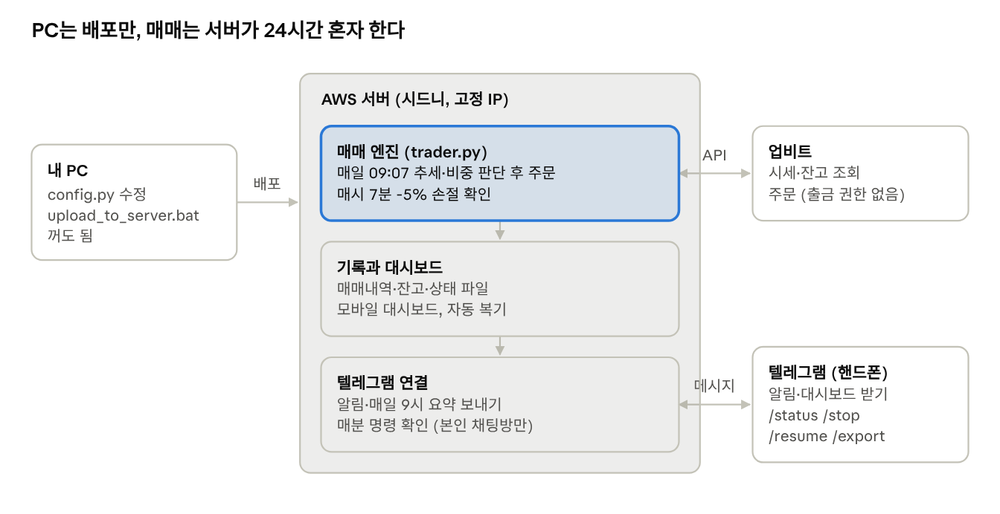
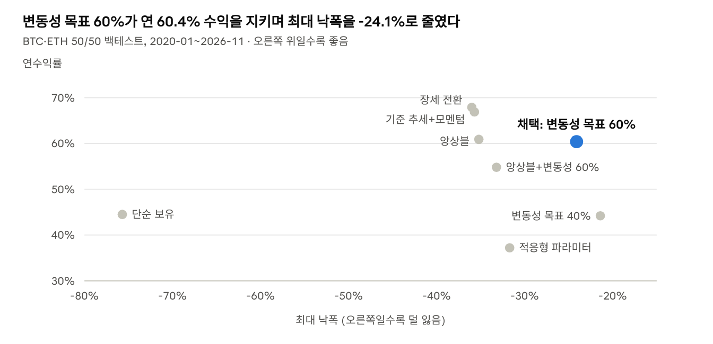

# 업비트 자동매매 시스템 기능 설명서

2026-11-27 · 전우성

## 시스템 한눈에 보기

이 시스템은 업비트에서 BTC·ETH를 하루 한 번 추세에 따라 사고팔고, 한 시간마다 손절을 확인하는 자동매매 봇이다. 클라우드 서버에서 24시간 돌고, 사용자는 텔레그램으로 결과를 받고 조종한다.

하루 흐름은 다음과 같다.

1. 09:00 업비트 일봉이 마감된다.
2. 09:07 매매 엔진이 코인별 추세와 변동성을 계산해 목표 비중을 정하고, 필요하면 주문한다.
3. 결과를 기록하고 대시보드를 다시 만든 뒤, 텔레그램으로 매일 요약과 대시보드를 보낸다.
4. 그 뒤 매시 7분마다 가격이 매수 평균가 대비 -5% 아래인지 확인해 손절한다.
5. 텔레그램 명령은 매분 확인한다. /stop을 보내면 다음 실행부터 주문을 멈춘다.

## 투자 전략과 설정 이유

전략은 한 문장으로 "오르는 추세일 때만 들고 있고, 시장이 사나울수록 적게 들고, 산 가격에서 5% 빠지면 판다"이다. 백테스트(2020-01~2026-11, BTC·ETH 50/50)에서 연 60.4%, 최대 낙폭 -24.1%를 기록했다. 같은 기간 단순 보유는 연 44.5%에 최대 낙폭 -75.7%였다.

### 전략 규칙 요약

| 구성 요소 | 규칙 | 하는 일 |
| --- | --- | --- |
| 장기 추세 필터 | 일봉 종가 > 200일 이동평균 | 하락장 전체를 피함 |
| 단기 모멘텀 필터 | EMA12 > EMA26 | 상승 힘이 살아 있을 때만 보유 |
| 변동성 목표 비중 | 비중 = min(1, 60% ÷ 최근 20일 연환산 변동성) | 사나운 장에서 자동으로 비중 축소 |
| 리밸런싱 밴드 | 목표와 10%p 이상 차이 날 때만 주문 | 불필요한 잔매매·수수료 절감 |
| 손절 | 평균 매수가 대비 -5% (장중, 1시간마다 확인) | 갑작스러운 급락에서 손실 제한 |
| 재진입 금지 | 손절 후 신호가 꺼졌다 다시 켜질 때까지 | 하락 추세에서 반복 손절 방지 |
| 종목·배분 | BTC 50%, ETH 50% | 분산, 유동성 확보 |
| 판단 시각 | 매일 09:07 (일봉 마감 09:00 직후) | 확정된 캔들만 사용 |

### 1. 왜 AI가 매번 판단하지 않고 규칙으로 하나

많이 알려진 AI 자동매매는 GPT에게 차트와 뉴스를 주고 매번 매수/매도를 묻는 방식이다. 이 방식에는 세 가지 문제가 있다.

- **검증이 안 된다**: 언어 모델은 과거 가격을 이미 학습했기 때문에 과거로 백테스트하면 답을 알고 치는 시험이 된다. 성과를 미리 확인할 방법이 없다.
- **같은 상황에서 다른 답을 한다**: 같은 입력에도 답이 바뀔 수 있어, 손실이 나도 원인을 분석하기 어렵다.
- **비용이 계속 든다**: 판단할 때마다 API 요금이 나간다.

규칙 기반 전략은 8년치 데이터로 미리 검증할 수 있고, 매매 하나하나의 이유를 설명할 수 있으며, 운영 비용이 0이다. AI는 매매 판단이 아니라 전략 연구·코딩·복기 단계에 썼다.

### 2. 왜 추세추종인가

코인 가격은 한 방향으로 오래 움직이는 경향이 강하다. 2018년과 2022년처럼 70~80% 빠지는 하락장이 있고, 반대로 몇 배씩 오르는 상승장도 있다. 이런 시장에서는 바닥과 꼭대기를 맞히는 것보다 "큰 하락장을 피하고 큰 상승장의 몸통을 타는" 것이 수익의 대부분을 만든다. 학계에서도 시계열 모멘텀(Moskowitz·Ooi·Pedersen, 2012)은 여러 자산군에서 관찰되는 현상이고, 암호화폐에서도 모멘텀이 수익률을 설명한다는 연구(Liu·Tsyvinski, 2021)가 있다.

실제 비교에서도 그랬다. 일봉 8년(2018~2026) BTC 기준으로 추세+모멘텀은 연 57.7%(최대 낙폭 -36.4%)이었고, RSI 역추세는 연 -7.3%, 눌림목 매수는 연 -3.1%였다. 반대 방향(떨어지면 사는) 전략은 코인 하락장에서 계속 물타기를 하며 깨졌다.

### 3. 왜 200일선과 EMA12/26을 둘 다 쓰나

두 필터는 다른 시간대를 본다. 200일선은 약 10개월의 큰 흐름으로, 이 아래에서는 상승 신호가 와도 대부분 하락장 안의 반등이다. EMA12/26(MACD와 같은 조합)은 몇 주 단위의 상승 힘을 본다. 둘 다 만족할 때만 보유하므로 "큰 흐름도 위, 최근 힘도 위"인 구간만 탄다. 하나만 깨져도 판다.

숫자를 최적화하지 않았다는 점이 중요하다. 200·12·26은 시장에서 가장 널리 쓰는 기본값이다. 견고성 검사에서 주변 값 12조합을 모두 돌려 보니 BTC는 검증 구간(2024-05 이후)에서 전부 플러스, ETH는 12개 중 10개가 플러스였다. 특정 숫자가 우연히 맞아서 좋은 결과가 나온 것이 아니라는 뜻이다.

### 4. 왜 변동성에 따라 비중을 조절하나 (가장 큰 개선)

추세추종만 쓰면 최대 낙폭이 -36% 수준이었다. 원인을 보니 큰 손실은 대부분 변동성이 폭발할 때 나왔다. 코인의 변동성은 몰려서 나타나는 성질(변동성 군집)이 있어서, 최근 20일이 사나웠으면 다음 며칠도 사나울 가능성이 높다. 그래서 변동성이 클수록 비중을 줄이면, 같은 수익을 더 적은 위험으로 얻을 수 있다. 주식에서 '변동성 관리 포트폴리오'(Moreira·Muir, 2017)로 알려진 방식이다.

계산은 간단하다. 최근 20일 연환산 변동성이 60% 이하면 비중 100%, 120%면 50%, 200%면 30%로 줄어든다. 남는 돈은 원화로 둔다.

**목표 변동성을 60%로 정한 이유**: 40%로 더 보수적으로 잡으면 낙폭은 -21.4%로 조금 더 줄지만, 연수익이 44.2%로 단순 보유와 비슷해진다. 60%는 수익을 거의 지키면서(66.9% → 60.4%) 낙폭을 3분의 1 줄였고(-35.7% → -24.1%), 수익 대비 낙폭을 나타내는 Calmar 비율이 2.51로 모든 후보 중 가장 높았다. 또 목표 40~80%, 계산 기간 10~60일의 모든 조합에서 낙폭이 -21~-29%로 기준(-36%)보다 작았다. 60%라는 숫자 하나에 기대는 효과가 아니다.

### 5. 왜 더 복잡한 전략을 택하지 않았나

"장세에 맞게 전략이 자동으로 바뀌는" 방식도 세 가지로 만들어 같은 조건에서 비교했다. 아래 그림에서 오른쪽(낙폭이 작음)이고 위쪽(수익이 큼)일수록 좋은 전략이다.

*프로젝트 백테스트 5차 · 후보 8개, 수수료·슬리피지 반영*

| 후보 | 연수익 | 최대 낙폭 | 샤프 | Calmar |
| --- | --- | --- | --- | --- |
| **채택: 추세+모멘텀 + 변동성 목표 60%** | **60.4%** | **-24.1%** | **1.66** | **2.51** |
| 추세+모멘텀 + 변동성 목표 40% | 44.2% | -21.4% | 1.59 | 2.07 |
| 기준 추세+모멘텀 | 66.9% | -35.7% | 1.54 | 1.87 |
| 장세 전환 | 67.9% | -36.0% | 1.56 | 1.89 |
| 앙상블 | 60.9% | -35.2% | 1.47 | 1.73 |
| 앙상블 + 변동성 60% | 54.8% | -33.2% | 1.55 | 1.65 |
| 적응형 파라미터 | 37.2% | -31.7% | 1.22 | 1.17 |
| 단순 보유 | 44.5% | -75.7% | 0.91 | 0.59 |

- **장세 전환**(상승장은 추세추종, 횡보장은 볼린저 밴드, 하락장은 현금): 연 67.9%로 수익은 가장 높았지만 낙폭이 -36.0%로 기본 추세추종과 거의 같았다. 횡보 판정이 드물어 사실상 같은 전략이었고, 복잡도만 늘었다.
- **적응형 파라미터**(매년 직전 2년에 가장 잘된 숫자로 교체): 연 37.2%로 가장 나빴다. 지난 시장에 맞춘 숫자가 다음 시장에서는 틀렸다(2024년 +32%, 기본 전략은 +119%). 과거 성과를 쫓아가는 것이 오히려 손해라는 점을 보여 준다.
- **앙상블**(12개 파라미터의 평균 비중): 거래만 4배로 늘고 개선은 없었다.
- **공포·탐욕 지수 추가**: 탐욕 필터는 효과가 0이었고, 공포에서 사는 역발상은 큰 손실을 냈다.

결론: "시장을 맞히려는" 복잡한 장치보다 "위험 크기를 일정하게 유지하는" 단순한 장치가 더 효과적이었다. 장세 적응은 변동성 비중이 이미 하고 있다. 시장이 사나워지면 비중이 줄고 잠잠해지면 늘어난다.

### 6. 왜 손절은 장중 -5%인가

손절 방식 6개를 세 기간(2018-07~, 2020~, 2024~)에서 비교했다. 장중 -5%는 세 기간 모두 최대 낙폭이 가장 작았다(2020~ 기준 -24.1%). 종가 기준 손절이나 손절 없음은 수익이 비슷하거나 조금 높았지만 낙폭이 -29% 수준으로 커졌다. 목표가 "크게 잃지 않기"이므로 낙폭이 가장 작은 쪽을 택했다.

| 손절 방식 | 2018-07~ 연수익 / MDD | 2020~ 연수익 / MDD | 2024~ 연수익 / MDD |
| --- | --- | --- | --- |
| **장중 -5% (채택)** | **53.4% / -23.1%** | **60.4% / -24.1%** | **28.6% / -23.0%** |
| 종가 기준 -5% | 56.7% / -28.5% | 59.1% / -29.2% | 32.4% / -27.5% |
| 종가 -5% + 장중 비상 -15% | 54.1% / -28.5% | 55.4% / -29.2% | 27.2% / -27.5% |
| 종가 -8% | 55.4% / -28.9% | 58.1% / -29.4% | 30.9% / -27.8% |
| 장중 -8% | 55.0% / -29.8% | 56.7% / -30.5% | 27.2% / -28.7% |
| 손절 없음 | 55.8% / -28.9% | 58.6% / -29.4% | 31.7% / -27.8% |

손절 기준을 매수 평균가로 둔 것은 "내가 산 가격에서 얼마나 잃었나"를 제한하기 위해서다. 손절 뒤에는 추세 신호가 한 번 꺼졌다 다시 켜질 때까지 사지 않는다. 이 규칙이 없으면 다음 날 바로 다시 사서 같은 하락에 두 번, 세 번 손절할 수 있다. 체결이 손절가보다 5% 나쁘게 되는 경우를 가정해도 연 56.5%, 낙폭 -26.7%로 전략이 유지됐다.

### 7. 왜 BTC와 ETH 50/50인가

두 코인은 업비트에서 거래량이 가장 많아 소액이든 큰 금액이든 체결이 안정적이다. 상승장 시점이 얼마간 달라 하나만 들 때보다 수익 곡선이 매끄럽다. 알트코인에서도 전략이 통하긴 했지만(XRP·SOL·ADA) 낙폭이 -50~-66%로 커졌고, DOGE는 검증 구간에서 손실이었다. 알트는 상장폐지 위험도 있어 제외했다.

### 8. 왜 일봉, 매일 09:07인가

4시간봉은 신호가 자주 바뀌어 거래 횟수와 수수료가 늘고 가짜 신호가 많다. 일봉은 큰 추세를 안정적으로 잡는다. 업비트 일봉은 한국 시각 09:00에 마감되므로, 마감이 확정된 뒤 7분에 판단한다. 정각 직후 모든 봇이 몰리는 시간도 피한다. 손절만 매시 7분마다 확인한다.

### 9. 이 전략이 약한 곳

- 승률이 낮다. 작은 손절이 여러 번 나고 소수의 큰 상승장에서 벌어 만회하는 구조다. 연속 손절 기간을 참아낼 수 있어야 한다.
- 횡보장에서 진입과 청산이 반복돼 조금씩 잃는다.
- 급등장 초반에는 200일선을 넘을 때까지 기다리므로 보유보다 늦게 탄다.
- 백테스트는 일봉이라 장중 급락(2024-12-03 계엄 플래시 크래시 등)에서의 실제 체결가는 더 나쁠 수 있다.
- 과거 성과가 미래 수익을 보장하지 않는다.

## 매매 엔진 기능

매매 엔진(trader.py)은 매시 7분에 실행되어 잔고 확인 → 신호 계산 → 주문 → 체결 확인 → 기록까지 한 번에 처리한다.

| 기능 | 내용 |
| --- | --- |
| 업비트 직접 연결 | 업비트 REST API를 JWT(HS256) 서명으로 직접 호출. 외부 라이브러리 변경에 영향받지 않음 |
| 일일 판단 | 09:07에 확정된 전날 일봉으로 코인별 목표 비중 계산, 10%p 이상 차이 나면 시장가 주문 |
| 시간별 손절 감시 | 매시 7분 현재가가 평균 매수가 대비 -5% 이하면 전량 매도 후 재진입 잠금 |
| 예산 관리 | 한도(5만 원)를 코인별로 나눠 관리. 한도를 바꾸면 다음 실행부터 자동 반영 |
| 주문 규칙 준수 | 최소 주문 5,000원 미만은 건너뜀, 매도 수량은 소수점 8자리 내림 |
| 체결 확인 | 주문 후 체결 완료까지 확인하고 실제 체결가·수수료로 기록 |
| 오류 재시도 | 업비트 일시 오류로 판단을 못 하면 다음 시간에 다시 시도 |
| 기록 | 매매내역(trades.csv), 매일 잔고(snapshots.csv), 상태(state.json), 실행 로그 |
| 모의투자 모드 | 같은 엔진으로 가상 자금 매매 가능 (전략 테스트용) |

## 안전장치

봇은 이상한 상황에서 계속 주문하는 대신 멈추고 알리도록 만들었다.

| 장치 | 작동 조건 | 하는 일 |
| --- | --- | --- |
| 출금 권한 없는 키 | 항상 | 키가 유출돼도 돈을 외부로 옮길 수 없음 |
| 금액 한도 | 항상 | 계좌에 돈이 더 있어도 한도(5만 원)까지만 사용 |
| 수동 정지 | STOP.txt 파일이 있음 (텔레그램 /stop) | 주문하지 않고 생존 신호만 기록 |
| 자동 정지 | 하루 주문 6회 초과, 체결 확인 시간 초과, 잔고 불일치 | STOP.txt를 만들고 텔레그램으로 이유 전송 |
| 멈춤 감지 | 매시 실행이 어느 순간 빠진 것을 발견 | 서버 재시작·네트워크 문제 가능성을 알림 |
| 중복 실행 잠금 | 이전 실행이 아직 끝나지 않음 | 두 번째 실행은 바로 종료 (10분 지난 잠금은 무시) |
| 오류 알림 제한 | 같은 오류 반복 | 6시간에 한 번만 알림 |
| 키 만료 경고 | 업비트 API 키 만료 30일 전 | 매일 요약에 경고 추가 |
| 로그 순환 | 로그 파일 2MB 초과 | 이전 로그를 log.old.txt로 밀고 새로 시작 |
| 텔레그램 본인 확인 | 항상 | 등록된 채팅방의 명령만 따름 |

## 대시보드와 자동 복기

대시보드는 핸드폰에서 보도록 만든 HTML 파일 하나다. 매 실행 후 새로 만들어지고, 매일 9시 텔레그램으로 오거나 /dashboard 명령으로 받는다. 색은 한국 식으로 상승·매수는 빨강, 하락·매도는 파랑이다.

| 탭 | 보여주는 것 |
| --- | --- |
| 요약 | 봇 상태(작동/정지/이상), 업비트 실제 잔고, 총 수익률, 코인별 보유·목표 비중, 200일선 대비 위치 게이지 |
| 차트 | 자산 추이(전략 vs 보유), 낙폭, 백테스트 기대치 vs 실제, 월별 수익률 표 |
| 매매일지 | 매수부터 매도까지 한 거래씩 카드로 정리, 거래마다 자동 복기 문장 |
| 점검 | 전략이 지금 장세에 맞는지 점검, 수정 제안과 그 제안을 적용했다면 어땠을지(what-if) |

**자동 복기**는 끝난 거래마다 유형을 분류한다. 추세를 잘 탄 수익, 손절 후 반등(매도 후 10일 안에 평균 매수가를 다시 넘음), 추세 종료 청산 같은 식이다.

**수정 제안**은 최근 거래가 특정 패턴을 보이면 나온다. 예를 들어 손절 후 반등이 잦으면 "손절폭 -8%"를, 횡보에서 손실이 잦으면 "진입 ADX 필터"를 제안하고, 그 설정으로 최근 기간을 다시 돌려 수익을 비교해 보여준다. 제안은 자동 적용되지 않는다. 한 번의 반등에 맞춰 규칙을 바꾸는 것이 과적합의 지름길이기 때문이다.

기술적으로는 자바스크립트 없이 만들었다. iOS 파일 미리보기가 스크립트를 막기 때문에, 상태는 서버에서 미리 계산하고 차트는 SVG, 탭은 CSS로 구현했다.

## 텔레그램 원격 조종

서버는 1분마다 텔레그램 메시지를 확인해서, 핸드폰으로 봇을 멈추거나 상태를 볼 수 있다. 등록된 본인 채팅방의 명령만 따른다.

| 명령 | 하는 일 |
| --- | --- |
| /status | 작동 여부, 잔고, 보유 코인, 마지막 실행 시각 |
| /stop | 매매 정지 (보유 코인은 그대로 둠) |
| /resume | 매매 재개 |
| /dashboard | 최신 대시보드 파일 전송 |
| /log | 최근 실행 기록 20줄 |
| /export | 매매내역·잔고 기록 CSV 전송 (세금 자료 보관용) |
| /help | 명령 목록 |

자동 알림도 온다. 매수·매도·손절이 일어날 때, 매일 9시 요약(잔고·수익률·대시보드 파일), 그리고 자동 정지·오류·멈춤 감지 때다.

## 서버 운영과 업데이트 방법

봇은 AWS Lightsail 서버(시드니, Ubuntu 24.04, 고정 IP YOUR_SERVER_IP)에서 돌아가서 PC를 꺼도 멈추지 않는다. 비용은 AWS 무료 플랜 크레딧($100)으로 충당하고 있다.

**자동 실행 (cron)**

- 매시 7분: 매매 엔진 실행 (하루 판단은 09:07, 나머지는 손절 감시)
- 매분: 텔레그램 명령 확인

**설정을 바꾸거나 업데이트할 때**

1. PC 폴더의 config.py를 메모장으로 열어 값을 바꾼다 (예: 한도 LIVE_MAX_KRW).
2. upload_to_server.bat을 더블클릭한다. PC 파일로 서버 패키지를 새로 만들고, 서버에 올려 설치까지 한다.
3. 텔레그램 /status로 정상인지 확인한다. 업데이트는 봇을 멈추지 않는다.

**설정값 (config.py)**

| 항목 | 현재 값 | 뜻 |
| --- | --- | --- |
| LIVE_MAX_KRW | 50,000 | 봇이 쓸 수 있는 최대 금액 (원) |
| VOL_TARGET | 0.6 | 목표 연변동성 60% |
| REBALANCE_BAND | 0.10 | 목표와 10%p 이상 차이 날 때만 주문 |
| STOP_LOSS | 0.05 | 손절폭 5% |
| LIVE_MAX_ORDERS_PER_DAY | 6 | 하루 최대 주문 수, 넘으면 자동 정지 |
| DAILY_SUMMARY | True | 매일 9시 텔레그램 요약 |
| ENTRY_MIN_ADX, TRAILING_STOP | None | 제안 기능용 옵션, 기본은 꺼짐 |

**보관할 것**: .env(업비트 키·텔레그램 토큰)와 .pem(서버 접속 키)은 절대 공유하지 않는다. 포트폴리오에 코드를 올릴 때도 이 두 파일은 빼야 한다.

## 파일 구성

코드는 파이썬 파일 13개와 실행용 배치·셸 스크립트로 이뤄져 있다. 연구용·옛 모의투자 파일은 PC의 _보관 폴더에 옮겨 두었다.

| 파일 | 역할 |
| --- | --- |
| trader.py | 매매 엔진: 업비트 연결, 주문, 기록, 안전장치 |
| strategies.py | 전략 규칙 (추세+모멘텀, 변동성 비중) |
| indicators.py | 지표 계산 (이동평균, 변동성, ADX) |
| backtest.py | 백테스트 엔진 (수수료·슬리피지·손절 반영) |
| data.py | 업비트 캔들 데이터 내려받기 (12시간 캐시) |
| review.py | 매매 복기와 전략 수정 제안 |
| dashboard.py | 모바일 대시보드 생성 |
| notify.py | 텔레그램 알림 보내기 |
| telegram_bot.py | 텔레그램 명령 처리 |
| live_trade.py, paper_trade.py | 실거래·모의투자 실행 입구 |
| config.py | 사용자가 바꾸는 설정값 |
| install.sh | 서버 설치 (파이썬 환경, cron 등록, 시간대) |
| make_server_zip.py | PC 파일로 서버 배포 패키지 생성 |
| upload_to_server.bat | PC에서 서버로 업로드·설치 (더블클릭) |
| live_check.bat | PC에서 업비트 연결 점검 |
| README.md, SERVER.md | 사용법과 서버 운영 안내 |
| .env, *.pem | 비밀 키 (공유·업로드 금지) |
